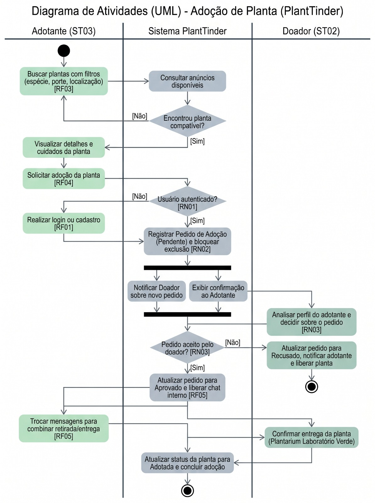
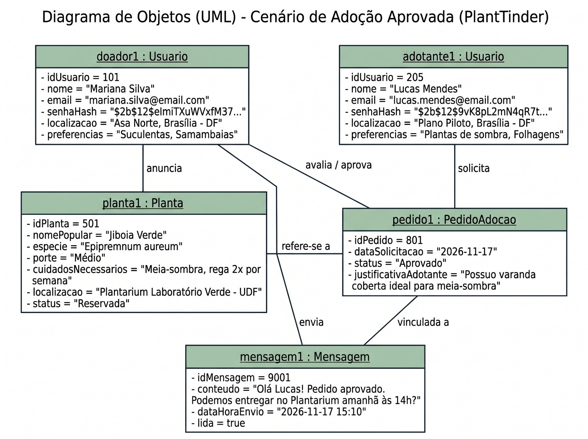

# Documentação UML

Esta pasta reúne os diagramas UML utilizados na modelagem do projeto **PlantTinder**, desenvolvido como parte da disciplina de Engenharia de Software.

Os artefatos desta seção representam o comportamento e a estrutura do sistema por meio da notação UML.

## Objetivos

- Representar graficamente o comportamento do sistema;
- Demonstrar a interação entre os elementos da aplicação;
- Organizar os artefatos de modelagem utilizados no projeto;
- Apoiar a documentação técnica e a análise dos requisitos.

## Artefatos

### Diagrama de Atividade

O diagrama de atividade apresenta o fluxo de ações e decisões executadas durante os processos do sistema.

<p align="center">
  
</p>

[Visualizar diagrama de atividade](https://github.com/jpedro-swe/Analise_Projeto_Sistema/blob/main/Documenta%C3%A7%C3%A3oUML/Diagrama_de_Atividade.jpg)

### Diagrama de Objetos

O diagrama de objetos representa instâncias de classes e os relacionamentos entre elas em um determinado momento da execução do sistema.

<p align="center">
  
</p>

[Visualizar diagrama de objetos](https://github.com/jpedro-swe/Analise_Projeto_Sistema/blob/main/Documenta%C3%A7%C3%A3oUML/diagramas_objetos_UML.jpeg)

## Estrutura da Pasta

```text
DocumentaçãoUML/
├── Readme.md
├── Diagrama_de_Atividade.jpg
└── diagramas_objetos_UML.jpeg
```

## Diagramas UML Utilizados

| Diagrama | Finalidade |
|---|---|
| Diagrama de atividade | Representar o fluxo sequencial das ações e as decisões do sistema |
| Diagrama de objetos | Evidenciar instâncias concretas e seus relacionamentos em um cenário específico |

## Relação com o Projeto

A modelagem UML complementa os demais artefatos acadêmicos disponíveis no repositório, como:

- documentação de requisitos;
- fichas de elicitação;
- priorização MoSCoW;
- estratégia e visão;
- casos de uso;
- documentação geral do PlantTinder.

Consulte também:

- [Projeto principal](../ProjetoAPS/)
- [README do repositório](../README.md)
- [Materiais da Unidade 4](../Unidade4/)

## Tecnologias e Formato

- Linguagem de modelagem: **UML**;
- Formato dos diagramas: **JPG** e **JPEG**;
- Documentação: **Markdown**.

## Licença

Os materiais deste repositório estão disponíveis sob a licença [CC0 1.0 Universal](../LICENSE).
