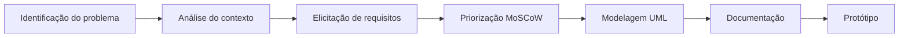

<div align="center">

# 🌱 Analise_Projeto_Sistema

### Engenharia de Software • UDF • Análise e Projeto de Sistemas

[](#-status-do-projeto)
[](#-sobre-o-repositório)
[](https://www.udf.edu.br)
[](LICENSE)

<br>

<a href="https://plantinderjhd.vercel.app/">
  
</a>
<a href="Documenta%C3%A7%C3%A3oUML/Readme.md">
  
</a>
<a href="MVP/README.md">
  
</a>

</div>

---

## 🌿 Sobre o repositório

Este repositório reúne os estudos, análises e artefatos desenvolvidos na disciplina **Análise e Projeto de Sistemas** do curso de Engenharia de Software da UDF.

O trabalho centraliza as etapas de engenharia de requisitos e modelagem do sistema **PlanTinder**, uma solução criada para auxiliar na escolha de plantas com base em preferências e necessidades do usuário.

### Objetivos

- 📋 Aplicar técnicas de levantamento e elicitação de requisitos;
- 🔎 Documentar contexto, objetivos e necessidades dos stakeholders;
- 🗂️ Organizar e priorizar requisitos com a abordagem MoSCoW;
- 🧩 Modelar processos e comportamentos por meio de diagramas UML;
- 📝 Consolidar conhecimento acadêmico em documentação técnica;
- 🌱 Desenvolver e apresentar um protótipo funcional do sistema.

---

## 🌱 Projeto PlanTinder

O **PlanTinder** é uma proposta de plataforma para aproximação entre pessoas e plantas, com foco em uma experiência simples e personalizada.

Os materiais do projeto incluem:

- definição de escopo e estratégia;
- ficha de elicitação de requisitos;
- priorização dos requisitos;
- visão estratégica;
- casos de uso;
- diagramas de atividade e objetos;
- protótipo publicado em ambiente web;
- entrega do MVP com pitch e vídeo de demonstração.

<div align="center">

### [🌐 Acessar o protótipo](https://plantinderjhd.vercel.app/) · [🌍 Versão no GitHub Pages](https://jpedro-swe.github.io/Analise_Projeto_Sistema/) · [📖 Estratégia e Visão](Unidade4/Estrat%C3%A9gia%20e%20Vis%C3%A3o%20-%20PlantTinder.pdf)

</div>

---

## 🧭 Navegação rápida

| Área | Conteúdo | Acesso |
|---|---|---|
| **Projeto principal** | Contexto, visão geral e documentação central | [ProjetoAPS](ProjetoAPS/) |
| **Requisitos** | Priorização dos requisitos com MoSCoW | [MoSCoW.md](ProjetoAPS/MoSCoW.md) |
| **Elicitação** | Ficha detalhada do requisito REQ-001 | [Ficha Markdown](ProjetoAPS/ficha-elicitacao-REQ-001.md) · [Ficha PDF](ProjetoAPS/Ficha%20de%20Elicita%C3%A7%C3%A3o%20-%20REQ-001%20PlantTinder.pdf) |
| **Estratégia** | Documento de estratégia e visão do produto | [Estratégia e Visão](Unidade4/Estrat%C3%A9gia%20e%20Vis%C3%A3o%20-%20PlantTinder.pdf) |
| **Casos de uso** | Listagem e descrição dos casos de uso | [CASOS_de_USO.md](Unidade4/ModelagemSistemas/CASOS_de_USO.md) |
| **Diagrama de casos de uso** | Representação gráfica dos casos de uso | [Abrir PDF](Unidade4/ModelagemSistemas/Use%20Case%20Diagram%20Team%20Whiteboard%20in%20Red%20Yellow%20Purple%20Trendy%20Stickers%20Style-3.pdf) |
| **Diagramas UML** | Atividade e diagramas de objetos | [Documentação UML](Documenta%C3%A7%C3%A3oUML/Readme.md) |
| **MVP** | Pitch, vídeo de demonstração e documentação da entrega | [MVP](MVP/README.md) · [Pitch (PDF)](MVP/PITCH.PlanTinder.pdf) |
| **Unidade 1** | Conteúdos introdutórios | [Unidade1](Unidade1/) |
| **Unidade 2** | Atividades da segunda unidade | [Unidade2](Unidade2/) |
| **Unidade 4** | Modelagem e visão do sistema | [Unidade4](Unidade4/) |

---

## 📂 Estrutura do repositório

```text
Analise_Projeto_Sistema/
├── 🌐 index.html · style.css · script.js   # Protótipo web (PlanTinder)
├── 🚀 MVP/                         # Entrega final do MVP
│   ├── README.md
│   ├── PITCH.PlanTinder.pdf
│   └── demonstraçãoPlanTinder.mp4
├── 📋 ProjetoAPS/                  # Documentação central do projeto
│   ├── Leiame.md
│   ├── MoSCoW.md
│   ├── ficha-elicitacao-REQ-001.md
│   └── Documentacao/
├── 🎓 Unidade1/                    # Introdução à disciplina
├── 🎓 Unidade2/                    # Atividades e análise de requisitos
├── 🎓 Unidade4/                    # Estratégia, visão e casos de uso
│   ├── Estratégia e Visão - PlantTinder.pdf
│   └── ModelagemSistemas/
├── 🧩 DocumentaçãoUML/             # Diagramas de atividade e objetos
├── ⚖️ LICENSE                     # Licença CC0 1.0
└── 📖 README.md
```

---

## 🧩 Metodologia

O conteúdo deste repositório acompanha as etapas fundamentais de análise e projeto de sistemas:



### Artefatos utilizados

- **Requisitos funcionais e não funcionais**;
- **Fichas de elicitação**;
- **Priorização MoSCoW**;
- **Casos de uso**;
- **Diagramas UML**;
- **Documento de estratégia e visão**;
- **Protótipo web**.

---

## 🖼️ Diagramas UML

<div align="center">

<a href="Documenta%C3%A7%C3%A3oUML/Diagrama_de_Atividade.jpg">
  
</a>
<a href="Documenta%C3%A7%C3%A3oUML/diagramas_objetos_UML.jpeg">
  
</a>

</div>

---

## 🚀 Como utilizar

### 1. Clonar o repositório

```bash
git clone https://github.com/jpedro-swe/Analise_Projeto_Sistema.git
cd Analise_Projeto_Sistema
```

### 2. Navegar pela documentação

```bash
cd DocumentaçãoUML
```

Os artefatos podem ser consultados diretamente pelo GitHub ou baixados para utilização acadêmica.

### 3. Acessar o PlanTinder

Abra o [protótipo publicado](https://plantinderjhd.vercel.app/) em seu navegador ou, para rodar localmente, basta abrir o arquivo `index.html` (site estático, sem dependências):

```bash
# opcional: servir localmente
python3 -m http.server 8000
# acesse http://localhost:8000
```

---

## 👥 Equipe

<div align="center">

<table>
  <tr>
    <td align="center"><a href="https://github.com/jpedro-swe"></a></td>
    <td><a href="https://github.com/jpedro-swe"><b>João Pedro Alves De Sousa</b></a><br><sub>@jpedro-swe</sub></td>
    <td align="center"><a href="https://github.com/brandao395"></a></td>
    <td><a href="https://github.com/brandao395"><b>Hélter Brandão De Oliveira</b></a><br><sub>@brandao395</sub></td>
  </tr>
  <tr>
    <td align="center"><a href="https://github.com/MF-DAVI"></a></td>
    <td><a href="https://github.com/MF-DAVI"><b>Davi Gonçalves Castro</b></a><br><sub>@MF-DAVI</sub></td>
    <td align="center"><a href="https://github.com/7deo"></a></td>
    <td><a href="https://github.com/7deo"><b>Jorge Luis Soares do Santos</b></a><br><sub>@7deo</sub></td>
  </tr>
</table>

</div>

---

## 📌 Status do projeto

O **MVP do PlanTinder foi entregue e publicado**. O repositório segue aberto como material acadêmico e documentativo, e novas análises, modelagens e melhorias poderão ser incorporadas.

- [x] Levantamento inicial de requisitos;
- [x] Priorização MoSCoW;
- [x] Estratégia e visão;
- [x] Casos de uso;
- [x] Diagramas UML;
- [x] Protótipo web publicado;
- [x] Entrega do MVP (pitch + vídeo de demonstração);
- [ ] Expansão e refinamento da documentação.

---

## 📄 Licença

Este repositório está disponível sob a licença **[CC0 1.0 Universal](LICENSE)**, permitindo reutilização e adaptação sem restrições.

## 💬 Contato

Dúvidas ou sugestões podem ser enviadas pela [área de issues](https://github.com/jpedro-swe/Analise_Projeto_Sistema/issues).

<div align="center">

**🌱 Engenharia de Software • UDF • Análise e Projeto de Sistemas 🌱**

</div>
